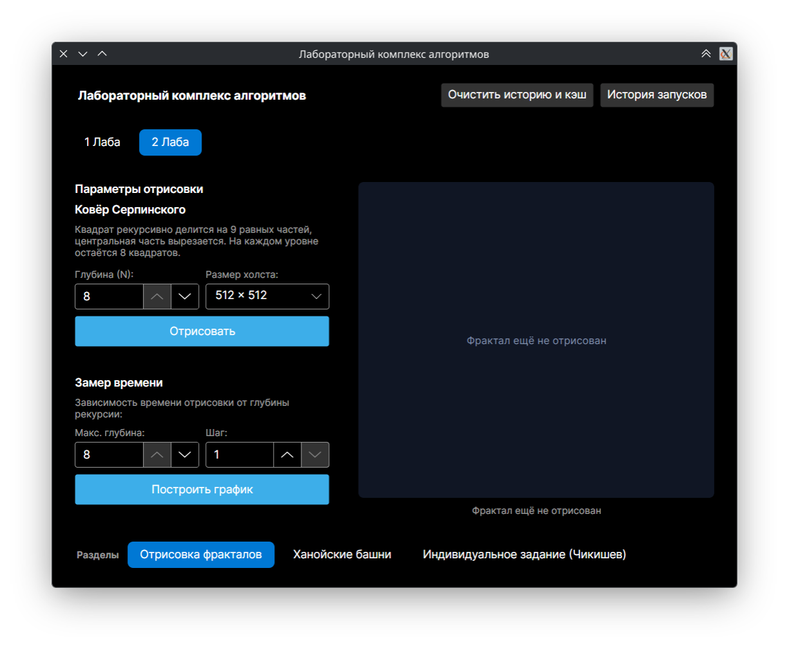
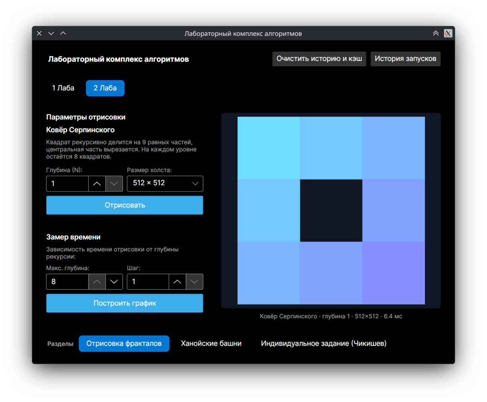
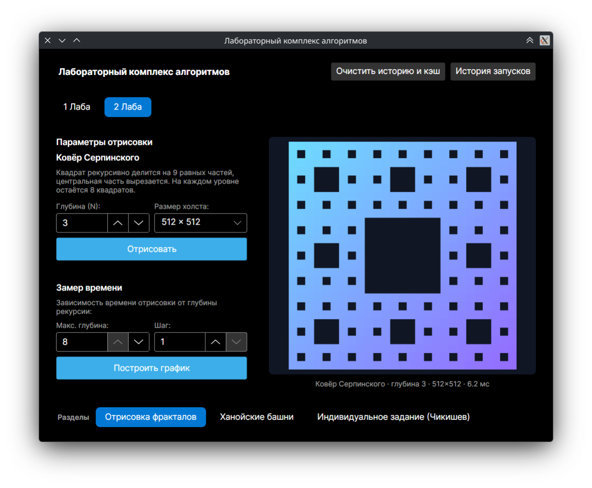
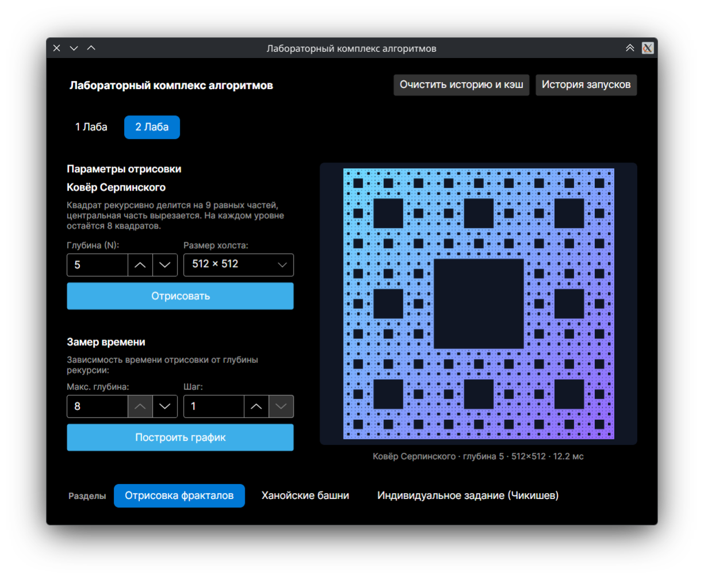
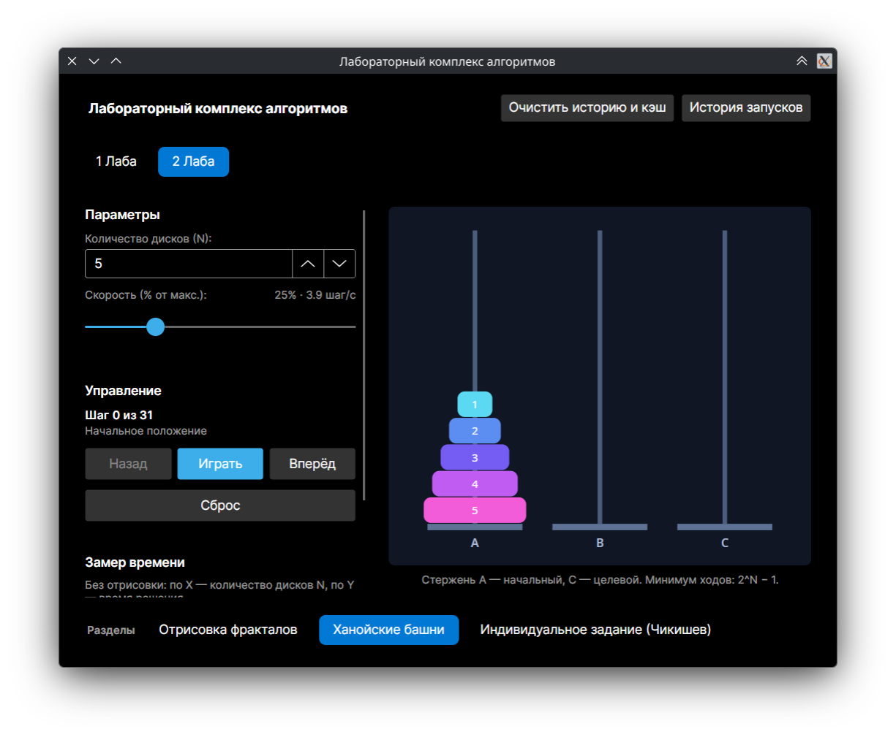
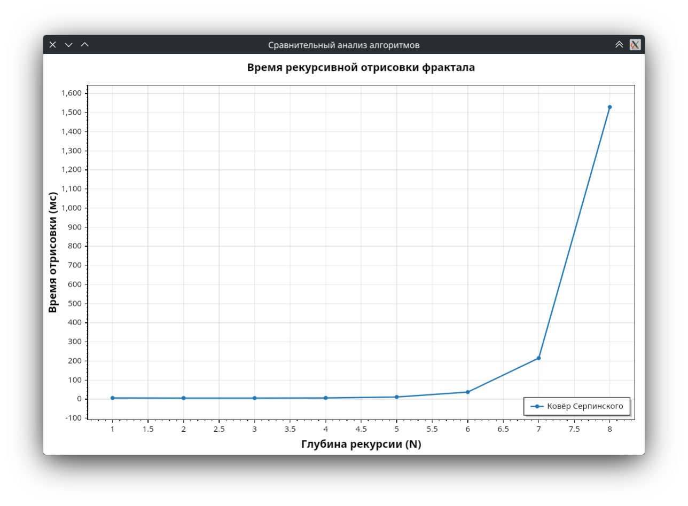
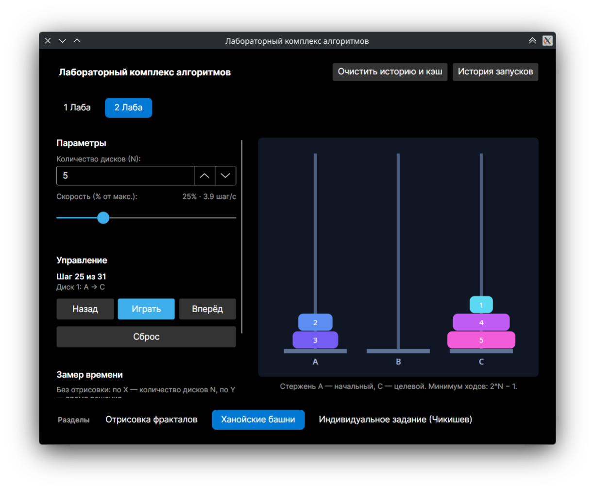
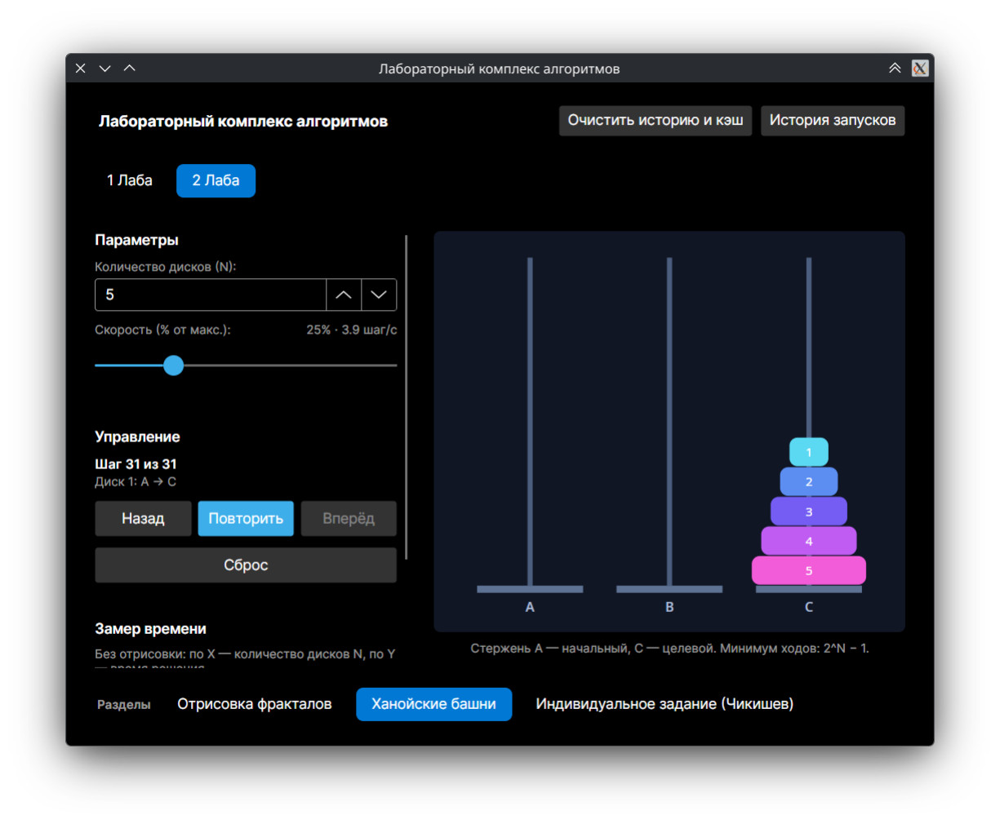
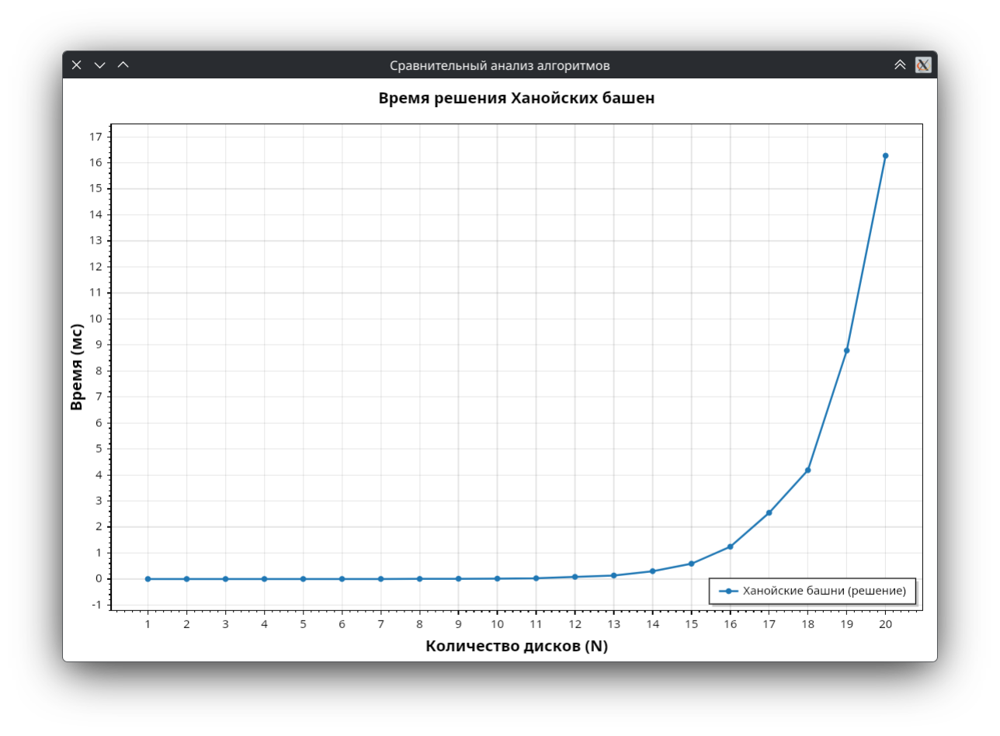
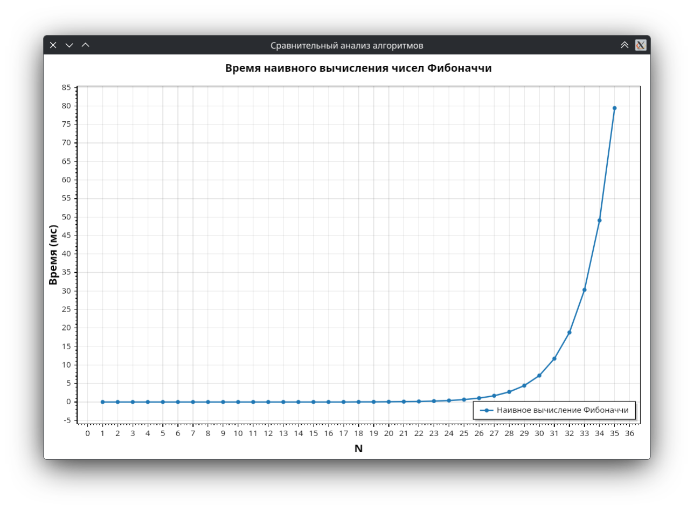

<!--
Сборка:
pandoc lab2.md -o lab2.pdf \
  --pdf-engine=xelatex \
  -H header.tex \
  -B titlepage.tex \
  -V lang=ru-RU \
  -V mainfont="Liberation Serif" \
  -V sansfont="Liberation Sans" \
  -V monofont="Liberation Mono" \
  -V fontsize=12pt
  
Нумерация разделов уже расставлена в заголовках, поэтому --number-sections использовать не нужно.
Изображения в reports/images, отмеченные как «ЗАГЛУШКА», предназначены для замены реальными скриншотами и графиками.
-->


# 1 Описание архитектуры приложения

## 1.1 Общая структура

Приложение `AlgosLabs` представляет собой настольное приложение на платформе .NET 10 с графическим интерфейсом Avalonia. Решение разделено на два проекта:

- `Algorithms` — библиотека классов с контрактами и реализациями алгоритмов, не зависящая от пользовательского интерфейса;
- `AlgosLabs` — приложение Avalonia, содержащее представления, модели представления, сервисы приложения и инфраструктуру доступа к данным.

Такое разделение позволяет использовать алгоритмы независимо от UI и упрощает их тестирование. Взаимодействие между слоями организовано по схеме MVVM: представления привязываются к моделям представления, а вычисления выносятся в отдельные сервисы и библиотеку алгоритмов.

Основные компоненты приложения приведены в таблице 1.

::: {custom-style="Table Caption"}
Таблица 1 — Основные компоненты приложения
:::

| Компонент | Назначение |
|---|---|
| `MainWindow`, `Sections` | Главное окно, верхняя навигация по лабораторным работам и нижняя навигация по разделам |
| `MainViewModel` | Состояние навигации, параметры разделов, команды запуска отрисовки и замеров |
| `HanoiViewModel` | Состояние, управление визуализацией и запуск замера Ханойских башен |
| `FibonacciViewModel` | Состояние раздела индивидуального задания, вычисление `F(N)` и запуск замера Фибоначчи |
| `ChartWindow` | Окно графика на базе ScottPlot |
| `AlgorithmScanner` | Поиск реализаций алгоритмов в загруженных сборках через рефлексию |
| `FractalBenchmarkService` | Замер времени отрисовки фрактала в зависимости от глубины |
| `HanoiBenchmarkService` | Замер времени построения решения Ханойских башен без визуализации |
| `FibonacciBenchmarkService` | Замер времени наивного вычисления чисел Фибоначчи без кэша и UI |
| `UniversalBenchmarkService` | Общий сервис замера алгоритмов и работы с кэшем |
| `HistoryService` | Построение истории запусков по записям кэша |
| `AppDbContext` | Контекст Entity Framework Core для SQLite |
| `Algorithms.Lab?.*` | Алгоритмы из лабораторной работы x |

## 1.2 Взаимодействие компонентов

При запуске приложение инициализирует базу данных, создаёт главное окно и модель представления `MainViewModel`. В конструкторе модели представления вызываются два ключевых метода:

1. `LoadAlgorithmsAutomatically()` — сканирует загруженные сборки и находит типы, реализующие интерфейсы алгоритмов;
2. `BuildLabs()` — формирует список лабораторных работ и разделов, создавая представления разделов один раз и сохраняя их в словаре `_sectionViews`.

Благодаря кэшированию представлений состояние раздела не теряется при переключении между разделами.

Последовательность работы с фракталом выглядит следующим образом:

1. Пользователь выбирает лабораторную работу «2 Лаба» и раздел «Отрисовка фракталов».
2. Задаёт глубину рекурсии и размер холста.
3. Команда `RenderFractalPreviewAsync` создаёт `FractalCanvas`, запускает `IFractalAlgorithm.Render` в фоновом потоке и замеряет время с помощью `Stopwatch`.
4. Полученный BGRA-буфер копируется в `WriteableBitmap` и отображается в предпросмотре.
5. Для построения графика команда `RunFractalBenchmarkAsync` вызывает `FractalBenchmarkService.Measure` и открывает окно `ChartWindow` со списком точек.

Для Ханойских башен взаимодействие построено иначе: `HanoiViewModel` один раз строит последовательность ходов через `TowerOfHanoi.Solve`, хранит текущий индекс шага и состояние стержней, а `HanoiTowersControl` отображает это состояние. Автоматическое воспроизведение выполняется таймером `DispatcherTimer`. При построении графика команда `RunHanoiBenchmarkAsync` вызывает `HanoiBenchmarkService.Measure`, который измеряет только `TowerOfHanoi.Solve`; визуализация и анимация в замер не входят.

Индивидуальное задание второй лабораторной работы реализовано в отдельном разделе с моделью представления `FibonacciViewModel`. Команда `ComputeFibonacciAsync` вычисляет `F(N)` через `NaiveFibonacci.Compute` и показывает результат, а `RunFibonacciBenchmarkAsync` вызывает `FibonacciBenchmarkService.Measure` и открывает `ChartWindow` с зависимостью времени от `N`. Замер не использует кэш и не включает работу интерфейса.

## 1.3 Схема базы данных

Для сохранения результатов замеров используется локальная база SQLite. В базе есть одна прикладная таблица `CacheEntries`, предназначенная для кэша измерений.

::: {custom-style="Table Caption"}
Таблица 2 — Поля таблицы `CacheEntries`
:::

| Поле | Тип SQLite | Ограничения | Назначение |
|---|---|---|---|
| `Id` | `INTEGER` | Первичный ключ, автоинкремент | Идентификатор записи |
| `CacheKey` | `TEXT` | `NOT NULL`, уникальный индекс | Ключ, однозначно определяющий замер |
| `AlgorithmId` | `TEXT` | `NOT NULL` | Идентификатор алгоритма |
| `N` | `INTEGER` | `NOT NULL` | Размер входных данных |
| `Step` | `INTEGER` | `NOT NULL` | Шаг алгоритма или прохода |
| `AverageTimeMs` | `REAL` | `NOT NULL` | Среднее время выполнения в миллисекундах |
| `CreatedAt` | `TEXT` | `NOT NULL` | Дата и время создания записи |

Уникальный индекс `IX_CacheEntries_CacheKey` не позволяет сохранить два одинаковых замера. Служебная таблица `sqlite_sequence` создаётся SQLite автоматически для автоинкрементного первичного ключа и в прикладной логике не используется.

## 1.4 Логика работы кэша

Ключ кэша формируется по формуле:

```text
{AlgorithmId}_{TData.Name}_N{N}_Step{Step}
```

Например, для некоторого алгоритма с идентификатором `algorithm-id`, типом данных `Double[]`, размером `N = 1000` и шагом `1` ключ будет иметь вид:

```text
algorithm-id_Double[]_N1000_Step1
```

Алгоритм работы кэша:

1. Перед выполнением замера сервис вычисляет ключ и пытается найти запись в `CacheEntries`.
2. При попадании в кэш сохранённое среднее время возвращается без повторного выполнения алгоритма.
3. При промахе выполняется прогрев: алгоритм несколько раз запускается на небольшом наборе данных, после чего вызывается сборка мусора.
4. Основной замер состоит из пяти серий. В каждой серии входные данные генерируются заново, затем алгоритм выполняется пять раз, а время делится на количество внутренних итераций.
5. Среднее значение по пяти сериям сохраняется в базу вместе с ключом, идентификатором алгоритма, `N`, шагом и временем создания.
6. При повторном запуске с теми же параметрами используется сохранённое значение.

Файл базы данных располагается рядом с исполняемым файлом:

```text
AppContext.BaseDirectory/benchmark_cache.db
```

Такой путь не зависит от текущего рабочего каталога и сохраняет кэш между пересборками. При запуске выполняется миграция: если рядом с исполняемым файлом базы ещё нет, но она есть в текущем каталоге, файл `benchmark_cache.db` и его служебные файлы `-wal` и `-shm` копируются к исполняемому файлу, после чего старые файлы удаляются. Для ускорения записи и уменьшения блокировок включается режим WAL:

```sql
PRAGMA journal_mode=WAL;
```

История запусков строится по тем же записям `CacheEntries`. Записи группируются по идентификатору алгоритма, шагу и минуте создания; для каждой группы вычисляются максимальное `N`, количество точек и время запуска.

Следует отметить, что общий кэш используется сервисом `UniversalBenchmarkService`, а замер фракталов в `FractalBenchmarkService` в текущей реализации выполняется отдельно и в базу не записывается. Это связано с тем, что результат зависит не только от глубины, но и от размера холста.

# 2 Описание работы приложения

## 2.1 Запуск и навигация

После запуска открывается главное окно с верхней навигацией по лабораторным работам. Для перехода ко второй лабораторной работе нужно нажать кнопку «2 Лаба». В нижней части окна появятся разделы:

- «Отрисовка фракталов»;
- «Ханойские башни»;
- «Индивидуальное задание (Чикишев)».

Выбранный раздел отображается в центральной части окна. При возврате к лабораторной работе восстанавливается последний открытый раздел. Состояние разделов сохраняется при переключении, поскольку представления создаются один раз и кэшируются.

{width=15cm}

## 2.2 Раздел «Отрисовка фракталов»

Раздел содержит панель параметров и область предпросмотра. Параметры приведены в таблице 3.

::: {custom-style="Table Caption"}
Таблица 3 — Параметры раздела «Отрисовка фракталов»
:::

| Параметр | Допустимые значения | Значение по умолчанию | Назначение |
|---|---|---|---|
| Глубина предпросмотра | 1–8 | 8 | Количество уровней рекурсии при отрисовке |
| Размер холста | 256 × 256, 512 × 512, 1024 × 1024 | 512 × 512 | Разрешение изображения и влияющая на замер площадь |
| Максимальная глубина замера | 1–8 | 8 | Последняя точка графика |
| Шаг глубины | 1–3 | 1 | Приращение глубины между точками |

Порядок работы:

1. Выберите раздел «Отрисовка фракталов».
2. Задайте глубину и размер холста.
3. Нажмите «Отрисовать». В области предпросмотра появится изображение, а под ним — название алгоритма, глубина, размер холста и время отрисовки.
4. Для исследования зависимости времени от глубины задайте максимальную глубину и шаг, затем нажмите «Построить график». Откроется отдельное окно с эмпирической кривой.

При глубине 8 и холсте 512 × 512 размер листа становится меньше пикселя, поэтому детализация ограничена разрешением холста, а время в основном определяется количеством рекурсивных вызовов. На рисунках 2–4 показаны результаты для разных уровней глубины; изображения являются заглушками и подлежат замене реальными скриншотами.

{width=9cm}

{width=9cm}

{width=9cm}

## 2.3 Раздел «Ханойские башни»

Раздел позволяет выбрать количество дисков, настроить скорость, управлять воспроизведением и строить график времени решения. Параметры приведены в таблице 4.

::: {custom-style="Table Caption"}
Таблица 4 — Параметры раздела «Ханойские башни»
:::

| Параметр | Допустимые значения | Значение по умолчанию | Назначение |
|---|---|---|---|
| Количество дисков `N` | 1–20 | 5 | Размер задачи |
| Скорость | 1–100 % | 25 % | Процент от максимальной скорости для текущего `N` |
| Максимальное `N` для графика | 1–20 | 20 | Последняя точка графика времени |
| Шаг графика | 1–5 | 1 | Приращение `N` между точками |

Максимальная скорость отрисовки зависит от количества дисков:

```text
HanoiMaxSpeed = min((2^N − 1) / 2, 1000) шагов/с
```

Фактическая скорость равна проценту от максимальной скорости для данного числа `N`. Например, при `N = 5` общее число ходов равно 31, максимальная скорость — 15,5 шагов/с, а при 25 % — около 3,9 шагов/с. Для больших `N` верхняя граница в 1000 шагов/с ограничивает скорость, поэтому за один тик таймера может выполняться несколько ходов.

Порядок работы:

1. Выберите количество дисков. При изменении `N` решение строится заново, а башня возвращается в начальное положение.
2. Нажмите «Вперёд» для выполнения одного хода или «Назад» для отката. При ручном управлении автоматическое воспроизведение останавливается.
3. Нажмите «Играть» для автоматического воспроизведения и «Пауза» для остановки.
4. Кнопка «Сброс» возвращает башню в начальное положение.
5. После завершения решения кнопка воспроизведения меняет текст на «Повторить».
6. Для графика задайте максимальное `N` и шаг, затем нажмите «Построить график». По оси X откладывается количество дисков `N`, по оси Y — время решения; отрисовка и анимация в замер не входят.

В разделе отображаются текущий шаг, общее количество ходов и информация о последнем перемещении. Стержни обозначены буквами `A`, `B` и `C`: `A` — начальный, `C` — целевой. Диски пронумерованы, меньший диск всегда располагается на большем.

{width=15cm}

# 3 Результаты исследования алгоритмов

## 3.1 Ковёр Серпинского

### 3.1.1 Название

Ковёр Серпинского (Sierpinski carpet).

### 3.1.2 Описание

Квадрат делится на девять равных квадратов, центральный квадрат вырезается, а с оставшимися восемью квадратами операция повторяется рекурсивно. В приложении глубина рекурсии ограничена значением 8, чтобы число вызовов оставалось обозримым.

### 3.1.3 Практическое применение

Ковёр Серпинского применяется прежде всего как геометрическая модель и элемент компьютерной графики:

- во фрактальных антеннах и частотно-избирательных поверхностях, где самоподобная геометрия влияет на диапазон рабочих частот;
- в метаматериалах и конструкциях с развитой поверхностью, например в компактных теплообменниках;
- в алгоритмах сжатия изображений, процедурной генерации текстур и моделировании пористых сред;
- в учебных задачах для демонстрации рекурсии, фрактальной размерности и экспоненциального роста числа элементов.

Как универсальный вычислительный алгоритм ковёр Серпинского не используется: при увеличении глубины число квадратов растёт как `8^d`, поэтому область применения ограничена задачами, где важна именно геометрия, а не объём вычислений.

### 3.1.4 Графики экспериментов и визуализация

Визуализация фрактала для глубин 1, 3 и 5 приведена на рисунках 2–4. График зависимости времени отрисовки от глубины приведён на рисунке 6. Файл графика является заглушкой: после запуска приложения в него нужно вставить реальный график, построенный кнопкой «Построить график».

{width=15cm}

Методика замера: холст 512 × 512, глубины от 1 до 8, три прогона на каждую точку, перед серией выполняется прогрев. Время в приложении измеряется с помощью `Stopwatch` и усредняется по трём прогонам.

Теоретическое число листьев и общее число рекурсивных вызовов приведено в таблице 5.

::: {custom-style="Table Caption"}
Таблица 5 — Рост числа элементов ковра Серпинского
:::

| Глубина `d` | Листьев `8^d` | Всего вызовов `(8^(d+1) − 1) / 7` | Доля площади `(8/9)^d` |
|---:|---:|---:|---:|
| 1 | 8 | 9 | 0,889 |
| 2 | 64 | 73 | 0,790 |
| 3 | 512 | 585 | 0,702 |
| 4 | 4 096 | 4 681 | 0,624 |
| 5 | 32 768 | 37 449 | 0,555 |
| 6 | 262 144 | 299 593 | 0,493 |
| 7 | 2 097 152 | 2 396 745 | 0,439 |
| 8 | 16 777 216 | 19 173 961 | 0,390 |

С ростом глубины доля закрашенной площади уменьшается, но количество рекурсивных вызовов растёт экспоненциально. Поэтому при фиксированном размере холста и больших `d` время определяется прежде всего обходом дерева рекурсии, а не площадью закрашенных пикселей.

### 3.1.5 Справочная оценка O-большое

Рекуррентное соотношение для числа вызовов:

```text
T(d) = 8 · T(d − 1) + O(1),  T(0) = O(1)
```

Отсюда:

```text
T(d) = O(8^d)
```

::: {custom-style="Table Caption"}
Таблица 6 — Теоретическая оценка ковра Серпинского
:::

| Случай | Время | Дополнительная память | Комментарий |
|---|---|---|---|
| Best | `Θ(8^d)` | `O(d)` | Структура детерминирована, все ветви обходятся одинаково |
| Average | `Θ(8^d)` | `O(d)` | Средний случай совпадает с худшим |
| Worst | `Θ(8^d)` | `O(d)` | Наихудший случай также определяется полным обходом дерева |

Если учитывать стоимость заливки пикселей, более точная оценка имеет вид `O(8^d + S^2 · (8/9)^d)`, где `S` — размер холста. При фиксированном `S` и росте `d` доминирует слагаемое `8^d`. Дополнительная память алгоритма — `O(d)` на стек рекурсии; сам холст занимает `O(S^2)`.

### 3.1.6 Листинг кода алгоритма

```csharp
namespace Algorithms.Lab2.Fractals;

/// <summary>
///     Ковёр Серпинского: рекурсивно делит квадрат на 9 частей и вырезает центральную.
/// </summary>
public sealed class SierpinskiCarpet : FractalAlgorithmBase
{
    public override string Id => "fractal-sierpinski-carpet";
    public override string Name => "Ковёр Серпинского";
    public override int MaxN => 8;

    public override string Description =>
        "Квадрат рекурсивно делится на 9 равных частей, центральная часть вырезается. " +
        "На каждом уровне остаётся 8 квадратов.";

    protected override void Draw(FractalCanvas canvas, int depth)
    {
        var size = Math.Min(canvas.Width, canvas.Height);
        var startX = (canvas.Width - size) / 2.0;
        var startY = (canvas.Height - size) / 2.0;

        DrawSquare(canvas, startX, startY, size, depth);
    }

    private static void DrawSquare(FractalCanvas canvas, double x, double y, double size, int depth)
    {
        if (depth <= 0)
        {
            // Цвет зависит от положения квадрата — фрактал получает плавный градиент
            var t = canvas.Width <= 0 ? 0 : (x + y) / (2.0 * canvas.Width);
            var (r, g, b) = FractalColors.ByFraction(t);
            canvas.FillRect(x, y, size, size, r, g, b);
            return;
        }

        var cell = size / 3.0;

        for (var row = 0; row < 3; row++)
        for (var col = 0; col < 3; col++)
        {
            if (row == 1 && col == 1) continue; // центральный квадрат вырезается

            DrawSquare(canvas, x + col * cell, y + row * cell, cell, depth - 1);
        }
    }
}
```

::: {custom-style="Image Caption"}
Листинг 1 — Реализация ковра Серпинского
:::

## 3.2 Ханойские башни

### 3.2.1 Название

Задача о Ханойских башнях (Tower of Hanoi), рекурсивный алгоритм переноса дисков.

### 3.2.2 Описание

Имеются три стержня и `N` дисков разного размера. Нужно перенести все диски с начального стержня на целевой, перемещая по одному диску за ход и не кладя больший диск на меньший. Классическое рекурсивное решение переносит `N − 1` диск на вспомогательный стержень, перемещает самый большой диск и повторяет операцию для оставшихся дисков.

### 3.2.3 Практическое применение

Задача используется:

- как учебный пример рекурсии, анализа сложности и построения индуктивных доказательств;
- для генерации кода Грея и изучения структуры графа Ханойских башен;
- в качестве модели при планировании резервного копирования и ротации носителей, где требуется переносить данные с ограничениями;
- в когнитивной психологии и задачах планирования действий как тест на построение последовательности операций.

В промышленных системах сам алгоритм Ханойских башен напрямую применяется редко: его основная ценность — демонстрация рекурсивного подхода и экспоненциальной сложности. Тем не менее задача полезна как эталон для проверки рекурсивных реализаций и визуализаторов.

### 3.2.4 Графики экспериментов и визуализация

На рисунке 5 показано начальное состояние, на рисунках 7 и 8 — промежуточное и конечное состояния башни. Это заглушки для скриншотов, которые нужно заменить после запуска приложения.

{width=12cm}

{width=12cm}

График зависимости времени решения от количества дисков приведён на рисунке 9. По оси X откладывается `N`, по оси Y — время, за которое башня собирается на целевом стержне. Замер выполняет только `TowerOfHanoi.Solve`: визуализация, анимация и обновление элементов управления в него не входят. Для каждой точки после прогрева выполняется три прогона, результат усредняется.

{width=15cm}

::: {custom-style="Table Caption"}
Таблица 7 — Минимальное число ходов для различных `N`
:::

| `N` | Минимальное число ходов `2^N − 1` |
|---:|---:|
| 1 | 1 |
| 3 | 7 |
| 5 | 31 |
| 10 | 1 023 |
| 15 | 32 767 |
| 20 | 1 048 575 |

### 3.2.5 Справочная оценка O-большое

Рекуррентное соотношение для числа ходов:

```text
T(n) = 2 · T(n − 1) + 1,  T(0) = 0
```

Решение:

```text
T(n) = 2^n − 1
```

::: {custom-style="Table Caption"}
Таблица 8 — Теоретическая оценка алгоритма Ханойских башен
:::

| Случай | Время | Дополнительная память | Комментарий |
|---|---|---|---|
| Best | `Θ(2^n)` | `O(n) + O(2^n)` | Для оптимального рекурсивного решения |
| Average | `Θ(2^n)` | `O(n) + O(2^n)` | Алгоритм детерминирован |
| Worst | `Θ(2^n)` | `O(n) + O(2^n)` | Любое решение требует не менее `2^n − 1` ходов |

Если хранить всю последовательность ходов, как в приложении, дополнительно требуется `O(2^n)` памяти. Стек рекурсии занимает `O(n)`. По числу перемещений алгоритм оптимален: нижняя граница `2^n − 1` достигается рекурсивным решением.

### 3.2.6 Листинг кода алгоритма

```csharp
using System.Collections.Generic;

namespace Algorithms.Lab2.Hanoi;

/// <summary>Один ход: какой диск и с какого стержня на какой нужно переместить.</summary>
public readonly record struct HanoiMove(int Disk, int From, int To);

/// <summary>
///     Классическое рекурсивное решение задачи «Ханойские башни» для трёх стержней.
///     Стержни нумеруются с нуля: 0 — начальный (A), 1 — вспомогательный (B), 2 — целевой (C).
/// </summary>
public static class TowerOfHanoi
{
    public const int RodCount = 3;

    /// <summary>Возвращает последовательность ходов для переноса <paramref name="diskCount" /> дисков.</summary>
    public static List<HanoiMove> Solve(int diskCount)
    {
        var moves = new List<HanoiMove>();
        if (diskCount > 0) Build(diskCount, 0, 2, 1, moves);
        return moves;
    }

    private static void Build(int diskCount, int from, int to, int auxiliary, List<HanoiMove> moves)
    {
        if (diskCount <= 0) return;

        Build(diskCount - 1, from, auxiliary, to, moves);
        moves.Add(new HanoiMove(diskCount, from, to));
        Build(diskCount - 1, auxiliary, to, from, moves);
    }
}
```

::: {custom-style="Image Caption"}
Листинг 2 — Рекурсивное решение задачи о Ханойских башнях
:::

## 3.3 Наивное вычисление чисел Фибоначчи (Чикишев)

### 3.3.1 Описание

Числа Фибоначчи задаются рекуррентно:

```text
F(0) = 0,  F(1) = 1,  F(n) = F(n − 1) + F(n − 2)  при n ≥ 2
```

В индивидуальном задании реализован наивный рекурсивный алгоритм, который вычисляет `F(n)` непосредственно по этому определению. Входные данные — целое число `n` от 0 до 35, результат возвращается в типе `long`. Промежуточные значения не запоминаются: при каждом обращении к `F(n − 1)` и `F(n − 2)` обе ветви рекурсии вычисляются заново, поэтому одни и те же значения находятся многократно.

Ограничение `n ≤ 35` выбрано из-за экспоненциального роста времени. При `n = 35` значение `F(35) = 9 227 465`, а число рекурсивных вызовов составляет около 29,9 млн. Дальнейшее увеличение `n` в интерактивном режиме быстро становится нецелесообразным, хотя тип `long` позволяет хранить числа Фибоначчи до `F(92)`.

### 3.3.2 Практическое применение

Наивная рекурсия для чисел Фибоначчи имеет прежде всего учебное и методическое значение:

- демонстрирует разницу между математическим определением и эффективной реализацией;
- служит эталоном для сравнения с мемоизацией, итеративным динамическим программированием и матричным возведением в степень;
- используется в задачах анализа алгоритмов как наглядный пример экспоненциальной сложности `Θ(φ^n)`;
- применяется для генерации небольших последовательностей и в учебных заданиях, где важна простота, а `n` мало.

В промышленных вычислениях наивную рекурсию не используют: для больших `n` она проигрывает даже простому итеративному алгоритму, которому требуется `O(n)` времени и `O(1)` дополнительной памяти. Сами числа Фибоначчи при этом встречаются в алгоритмах поиска, хеширования, сжатия данных и математического моделирования.

### 3.3.3 Графики экспериментов и визуализация

График зависимости времени вычисления от `N` приведён на рисунке 10. По оси X откладывается номер числа Фибоначчи `N`, по оси Y — среднее время вычисления в миллисекундах.

{width=15cm}

Методика замера: `FibonacciBenchmarkService.Measure` измеряет только вызов `NaiveFibonacci.Compute`, без работы интерфейса, кэша и построения графика. Перед серией выполняется прогрев JIT, для каждой точки — три прогона, результат усредняется; перед точкой выполняется сборка мусора, чтобы её время не попадало в измерение. На текущей машине при `N = 30` время составляет около 5–6 мс, а при `N = 35` — несколько десятков миллисекунд (около 30–60 мс). Небольшие колебания отдельных точек объясняются накладными расходами среды выполнения, но общая экспоненциальная тенденция выражена отчётливо.

### 3.3.4 Справочная оценка O-большое

Число вызовов `C(n)` для наивного рекурсивного вычисления удовлетворяет соотношению:

```text
C(n) = C(n − 1) + C(n − 2) + 1,  C(0) = C(1) = 1
```

Отсюда `C(n) = 2F(n + 1) − 1`, а так как `F(n)` растёт как `φ^n / √5`, где `φ = (1 + √5) / 2 ≈ 1,618`, получаем:

```text
T(n) = Θ(φ^n)
```

Оценка `O(2^n)` также верна, но менее точна: она завышает скорость роста по сравнению с `Θ(φ^n)`. Алгоритм детерминирован, поэтому для фиксированного `n ≥ 2` лучший, средний и худший случаи совпадают.

::: {custom-style="Table Caption"}
Таблица 9 — Теоретическая оценка наивного вычисления чисел Фибоначчи
:::

| Случай | Время | Дополнительная память | Комментарий |
|---|---|---|---|
| Best | `Θ(φ^n)` | `O(n)` | Для `n ≥ 2`; при `n = 0, 1` — `O(1)` |
| Average | `Θ(φ^n)` | `O(n)` | Алгоритм детерминирован |
| Worst | `Θ(φ^n)` | `O(n)` | Число вызовов не зависит от значений входа |

Дополнительная память `O(n)` расходуется на стек рекурсии. Без кэша повторные вычисления одной и той же ветви являются основной причиной экспоненциального времени; мемоизация снижает сложность до `O(n)`.

### 3.3.5 Листинг кода алгоритма

```csharp
using Algorithms.Interfaces;

namespace Algorithms.Lab2.IndividualTasks;

/// <summary>
///     Наивное рекурсивное вычисление чисел Фибоначчи:
///     F(0) = 0, F(1) = 1, F(n) = F(n − 1) + F(n − 2).
///     Промежуточные значения не кэшируются, поэтому число вызовов растёт экспоненциально.
/// </summary>
public sealed class NaiveFibonacci : IAlgorithm<int>
{
    /// <summary>
    ///     Ограничение связано с экспоненциальным временем: при n = 35 выполняется
    ///     около 30 млн рекурсивных вызовов, дальнейший рост быстро становится заметным.
    /// </summary>
    public const int MaxSupportedN = 35;

    public string Id => "naive-fibonacci";

    public string Name => "Наивное вычисление чисел Фибоначчи (Чикишев)";

    public int MaxN => MaxSupportedN;

    public string Description =>
        "Рекурсивно вычисляет F(n) по определению, без мемоизации и динамического программирования. " +
        "Используется как учебный пример экспоненциальной сложности.";

    /// <summary>Вход алгоритма — само число n.</summary>
    public int Generate(int n) => n;

    public void Execute(int n, int step)
    {
        // step для этого алгоритма не нужен: размер входа задаётся одним значением n.
        var value = Compute(n);
        GC.KeepAlive(value);
    }

    /// <summary>Возвращает n-е число Фибоначчи, вычисляя каждую ветвь рекурсии заново.</summary>
    public static long Compute(int n)
    {
        if (n < 0) throw new ArgumentOutOfRangeException(nameof(n));
        return n <= 1 ? n : Compute(n - 1) + Compute(n - 2);
    }
}
```

::: {custom-style="Image Caption"}
Листинг 3 — Наивное рекурсивное вычисление чисел Фибоначчи
:::

# 4 Выводы

В ходе работы была рассмотрена архитектура приложения `AlgosLabs` и реализация второй лабораторной работы. Приложение разделено на библиотеку алгоритмов и слой пользовательского интерфейса, что позволяет независимо развивать вычислительную часть и визуализацию. Для хранения результатов замеров используется локальная база SQLite с таблицей `CacheEntries`, уникальным ключом и режимом WAL; кэш сохраняется рядом с исполняемым файлом и не зависит от рабочего каталога.

Для второй лабораторной работы реализованы три рекурсивных алгоритма:

- ковёр Серпинского с ограничением глубины 8, предпросмотром на холсте 256 × 256, 512 × 512 или 1024 × 1024 и замером времени отрисовки;
- рекурсивное решение задачи о Ханойских башнях с количеством дисков до 20, пошаговым управлением, откатом, автоматическим воспроизведением, регулировкой скорости в процентах от максимума и графиком времени построения решения без отрисовки;
- наивное вычисление чисел Фибоначчи с ограничением `N ≤ 35`, отдельным разделом приложения и графиком времени вычисления.

Теоретический анализ показывает, что ковёр Серпинского имеет экспоненциальную сложность `Θ(8^d)` по глубине рекурсии, Ханойские башни — `Θ(2^n)` по числу дисков и оптимальное число ходов `2^n − 1`, а наивное вычисление чисел Фибоначчи — `Θ(φ^n)`, где `φ ≈ 1,618`. Эти оценки согласуются с поведением приложения: при увеличении глубины фрактала, количества дисков и номера числа Фибоначчи резко возрастает число рекурсивных вызовов.

В текущей версии замер фракталов не сохраняется в общий кэш, поскольку зависит от размера холста. Индивидуальное задание второй лабораторной работы реализовано в разделе «Индивидуальное задание (Чикишев)»: оно содержит вычисление `F(N)`, замер времени без кэша и построение графика зависимости времени от `N`.
